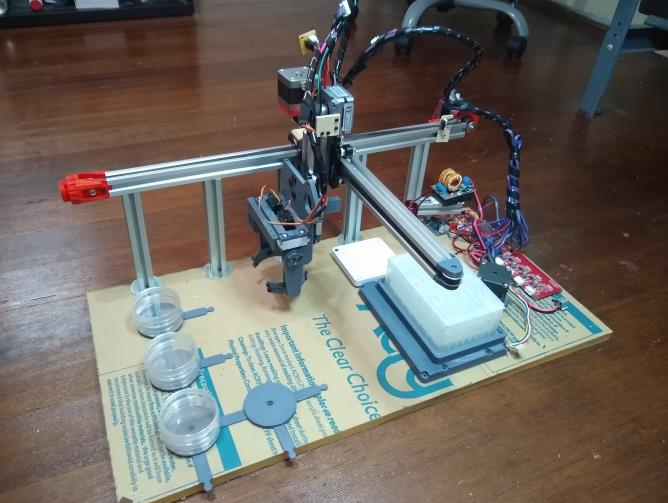
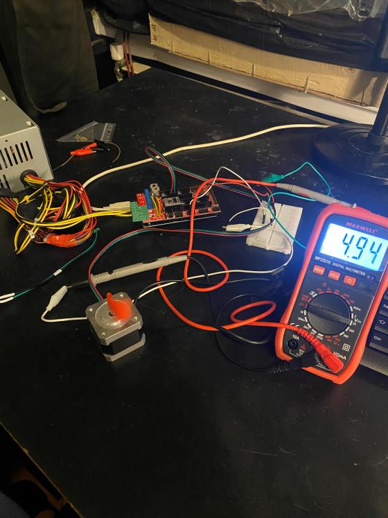
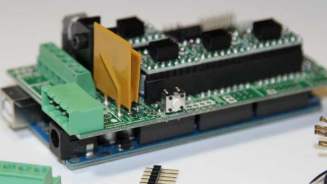
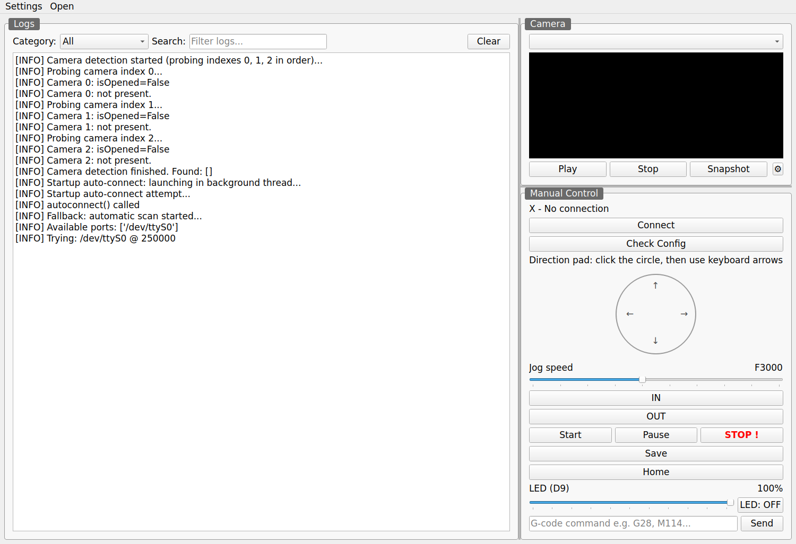
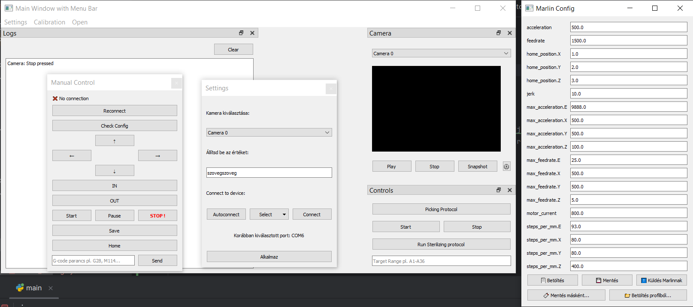
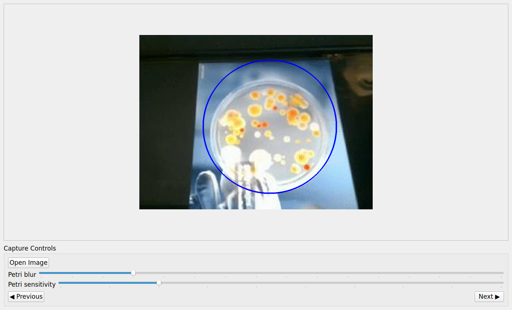
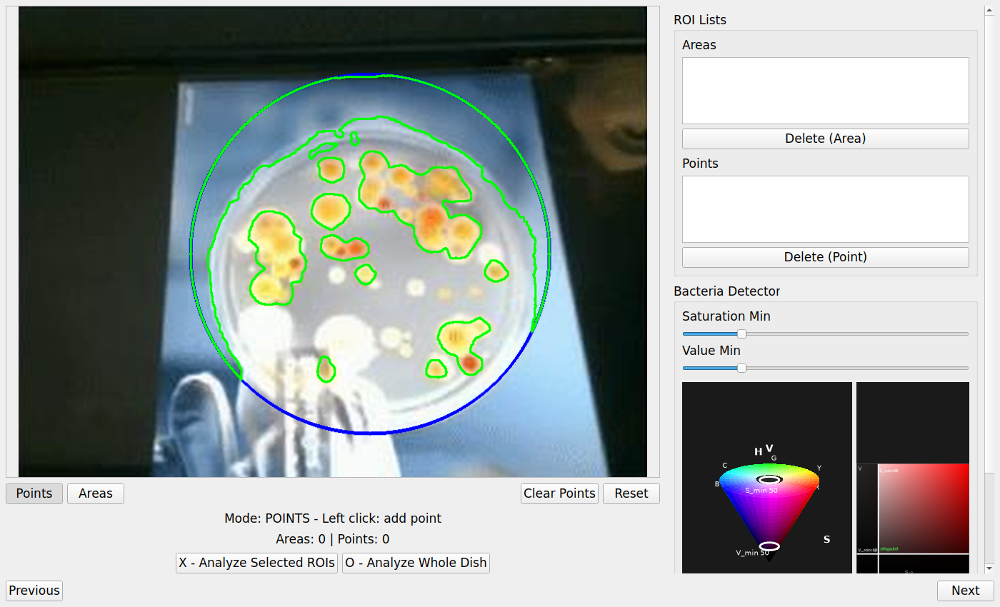
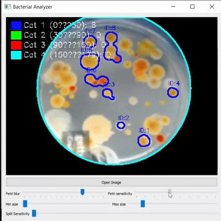

# Colono Picker – Automated Laboratory Device

An open, low-cost **colony picker** for Petri dishes: a gantry robot built from 3D-printer parts that photographs a dish, finds the bacterial colonies on it and moves a needle to them. The project covers both the hardware and the software; this repository is the software side, written in Python.

The software has three main parts: **hardware control** (G-code over serial to Marlin), **image processing** (OpenCV) and a **graphical user interface** (PyQt5). Development is in progress.


<p align="center">
  
  
</p>

## System architecture

The Marlin firmware runs on the microcontroller (Arduino Mega + RAMPS 1.4), which talks to the computer over a USB serial port. On the computer, the Python application sends G-code commands and reads the replies over that connection.


| Layer | Hardware / technology | Role |
|---|---|---|
| Controller | Arduino Mega 2560 + RAMPS 1.4, ATX power supply | Stepper drivers, end stops, LED (D9) PWM |
| Firmware | [Marlin](https://marlinfw.org/) | G-code interpreter (`G0/G1`, `G28`, `M17/M18`, `M42`, `M112`, …) |
| PC software | Python, PyQt5, OpenCV, PySerial | GUI, camera, image processing, motion control |

<p align="center">
  
</p>

## The GUI

The main window has dockable panels for **Logs** (filterable by category and searchable), **Camera** (live view, snapshot, camera settings) and **Manual Control** (connect, check config, jog pad with adjustable speed, IN/OUT, Start/Pause/**STOP**, Home, LED brightness and a free-text G-code field).



Menus:

- **Settings → Marlin config** – view and edit the Marlin parameters (steps/mm, feedrate, acceleration, jerk, motor current), save them to a profile and send them to the board.
- **Settings → Pixel / mm calibration** – calibrate the camera scale (the `centi_foto.jpg` ruler image can be used as a reference).
- **Settings → Pipeline Maximize** – open the photo pipeline full screen.
- **Open → Motion Calibration (X/Y)** – calibrate the axes.

<details>
<summary>Earlier GUI version (from the project presentation)</summary>



</details>

## Image processing pipeline

The photo pipeline is a four-step wizard (`GUI/custom_widgets/photo_pipeline/`):

1. **Capture** – open or take a picture; the Petri dish is found with a Hough circle transform (`Image_processing/petri_detector.py`). *Petri blur* and *Petri sensitivity* tune the detection.
2. **ROI** – choose points or areas on the dish, or analyse the whole dish. Colonies are segmented by HSV thresholding, contour search and an area filter (`Image_processing/BacteriaDetector.py`). The embedded HSV cone and cross-section show which colours the *Saturation Min* / *Value Min* sliders keep.
3. **Summary** – review the selected regions and target points.
4. **Picking** – order the targets by nearest neighbour and move the gantry to them one by one with `G0` commands; STOP clears the queued moves.

| 1. Petri dish detection | 2. Colony detection + HSV visualiser |
|---|---|
|  |  |

<details>
<summary>Earlier prototype: Bacterial Analyzer</summary>



</details>

## Project structure

```
AutoLab/
├── main.py                          # entry point: QApplication + MainWindow
├── GUI/
│   ├── main_window.py               # main window, menus, docks
│   └── custom_widgets/
│       ├── mainwindow_components/   # camera, log, camera settings
│       ├── openable_widgets/        # manual control, Marlin config, calibrations
│       └── photo_pipeline/          # 4-step image processing wizard + HSV visualiser
├── Image_processing/                # PetriDetector, BacteriaDetector, overlay drawing
├── Pozitioner_and_Communicater/     # GCodeControl (serial, Marlin probe), CommandSender thread, G-code presets
├── File_managers/                   # YAML settings, Marlin profile, dish profiles
├── centi_foto.jpg                   # ruler image for pixel/mm calibration
└── Bako_Andras_Önlab.pdf            # project presentation (Hungarian)
```

## Getting started

Requirements: Python 3.11+, a USB camera and a Marlin board (the GUI also starts without them; it then shows *No connection*).

```bash
python -m venv venv
source venv/bin/activate        # Windows: venv\Scripts\activate
pip install -r requirements.txt
python main.py
```

On startup the application:

- probes camera indexes 0–2,
- tries to connect to the last used serial port, then scans all ports (default baud rate **250000**, then 125000, 500000 and 115200).

Settings are saved as YAML files in the `config_profiles/` folder (`settings.yaml`, `marlin_settings.yaml`, `calibration.yaml`, `detector_params.yaml`, `dish_profiles.yaml`). `*.yaml` is in `.gitignore`, so these files are not committed.

## Status and next steps

**Now:** a well-structured, extensible codebase with manual control, calibration and a working detection pipeline.

**Next:** better image processing, full integration of the mechanics, and automation logic (the whole picking run without manual steps).

More detail is in the project presentation: [`Bako_Andras_Önlab.pdf`](Bako_Andras_Önlab.pdf) (Hungarian).
